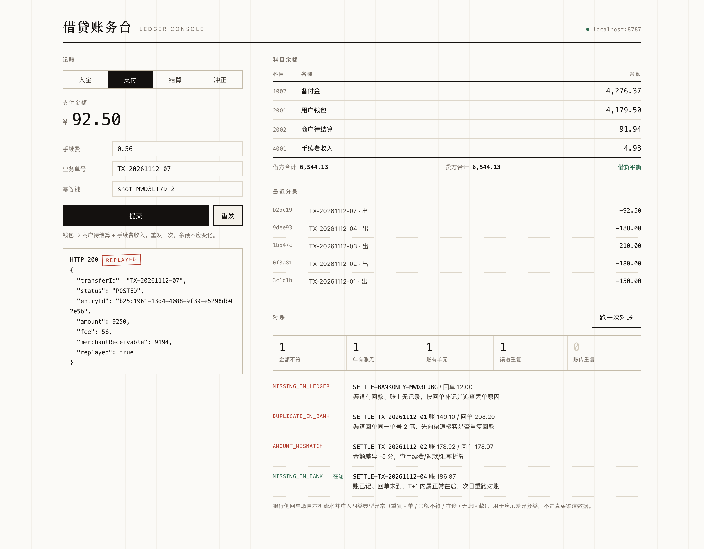

# lending-ledger · 借贷账务最小闭环

**复式记账 · 幂等 · 状态机 · 冲正 · 对账**，TypeScript + SQLite，零运行时依赖，`git clone` 后直接跑。

[](https://github.com/dok4everak47/lending-ledger/actions/workflows/ci.yml)
[](https://nodejs.org)
[](LICENSE)

> 对「金融系统怎么保证钱不出错」的一个可运行回答。
> 不是框架，不是脚手架，是五个真实难点各一份能跑、能测、讲得清取舍的最小实现。

## 快速开始

```bash
node --version               # >= 24（用原生 TypeScript 类型擦除，不需要 tsc / tsx）
node --test test/*.test.ts   # 56 个用例（含 6 进程真并发）
node src/demo.ts             # 一条从支付到对账的完整流水线
node src/api/http.ts         # 起服务，端口 8787；浏览器打开 http://localhost:8787/ 有操作台
```

只有类型检查需要装依赖（一个 `@types/node`，没有运行时包）：

```bash
npm ci && npm run typecheck
```

## 目录

- [为什么是这五件事](#为什么是这五件事)
- [结构](#结构)
- [几个刻意的设计决定](#几个刻意的设计决定)
- [演示输出](#演示输出)
- [操作台](#操作台)
- [截图](#截图)
- [HTTP 契约](#http-契约)
- [明确没做的](#明确没做的知道边界比假装完整重要)
- [设计笔记](docs/design-notes.md)
- [自测结果](#自测结果)
- [开发](#开发)
- [许可证](#许可证)

## 为什么是这五件事

金融后台真正难的不是 CRUD，是「钱错了怎么办」。这五件事恰好对应一份金融科技 JD 里最常见的四句话：

| JD 原话 | 本仓库对应实现 |
|---|---|
| 资金、账务、清结算的领域建模 | 复式记账（`journal_entries` + `postings`），科目类型决定余额方向 |
| 幂等、事务补偿 | 幂等键唯一索引 + 两态（IN_PROGRESS / COMPLETED）+ 冲正分录 |
| 状态机 | 转账单 6 态、显式迁移表，非法迁移直接抛错 |
| 对账 | 五类差异分类 + 在途窗口，每类给出处置建议 |

## 结构

```
src/
  domain/            纯领域，无 IO
    money.ts         金额 = 最小货币单位整数（分），拒绝任何浮点参与运算
    accounts.ts      科目类型 / 正常余额方向 / 借贷方向
    journal.ts       分录不变量：有借必有贷、借贷必相等、金额为正整数
    state-machine.ts 状态迁移表（CREATED → AUTHORIZED → POSTED → SETTLED，旁支 FAILED / REVERSED）
  store/
    schema.sql       表结构 + CHECK / UNIQUE / 部分唯一索引
    db.ts            node:sqlite 封装，BEGIN IMMEDIATE + 嵌套事务复用
    idempotency.ts   幂等执行器：唯一索引即锁，同 key 异参判冲突
  ledger/ledger.ts   记账核心：写分录、算余额、冲正、试算平衡、取流水
  payments/pay.ts    业务编排：支付（抽手续费）、结算出款、整单冲正
  recon/reconcile.ts 对账：按 externalRef 匹配，输出五类差异
  api/http.ts        10 个端点（含操作台与健康检查），错误码即契约（402 / 409 / 422）
test/                56 个用例：领域单测 + 账务不变量 + 6 进程真并发 + 黄金端到端 + HTTP 端到端
public/index.html    单文件操作台：记账、余额、流水、对账（无构建步骤，直接由上面的服务托管）
scripts/             截图脚本（capture.mjs 用 Playwright，screenshot.sh 用本机浏览器）
docs/                截图与设计笔记
```

## 几个刻意的设计决定

**1. 金额只有整数分**

`0.1 + 0.2 !== 0.3` 在账务里不是冷知识，是一笔对不上的账。所有金额都是 `number`（安全整数校验），解析时超过两位小数直接报错而不是悄悄舍入。

**2. 分录只追加，改账只能靠冲正**

原分录永远不动，冲正生成一笔方向相反的等价分录。这是审计要求，也是排查问题时的唯一可靠线索。`journal_entries.reversal_of` 上有一个**部分唯一索引**，从库层面保证「一笔分录只能被冲正一次」——不依赖应用层的「先查再写」（那在并发下必漏）。

**3. 幂等键用唯一索引当锁**

不是「查一下有没有，没有就插」，而是直接插，插失败再按 `fingerprint` 判断是重放还是冲突：

- 同 key 同参 → 返回首次响应，`replayed: true`
- 同 key 异参 → 409，绝不静默执行
- 同 key 处理中 → 409，让客户端退避重试，而不是并发扣两次钱

失败的业务执行会让幂等键一起回滚，所以「失败的请求」不留脏键，重试会真的重跑。

这条不靠自述，靠测试：`test/concurrency.test.ts` fork **6 个真进程**同时用同一把键重试同一笔支付，断言只有一个进程真正扣款、其余全是重放、账簿只多一笔分录、并发之后依然借贷平衡。

**（3 的延伸）并发靠数据库串行化，不靠应用层加锁**

`BEGIN IMMEDIATE` 一上来就拿写锁，配合 `busy_timeout` 让并发请求排队而不是立刻失败。跨进程的锁竞争交给 SQLite，应用层不写自己的 mutex——mutex 在多实例部署下等于没有。

**4. 余额校验在事务里、状态推进之前**

余额不足时先把状态推到 FAILED 再抛错，整个事务回滚——调用方拿到 402，账上不多不少。

**5. 对账必须分类，不能只报总数**

```
AMOUNT_MISMATCH     金额不符（手续费 / 退款 / 汇率）
MISSING_IN_LEDGER   渠道有、账上没有 → 补记并追溯丢单
MISSING_IN_BANK     账上有、回单没到 → T+1 内算在途，超窗追单
DUPLICATE_IN_BANK   渠道重复回单
DUPLICATE_IN_LEDGER 账内重复入账 → 冲正
```

「总量轧平」是陷阱：一笔多记 100、一笔少记 100，净差为 0 但差异仍在。所以 `reconciled` 同时要求「无差异 + 净差为 0」，测试里专门钉了这一条。

## 演示输出

```
【支付 TX-A：100.00 元，手续费 0.60 元】
  第 1 次：entry=f59813a1 replayed=false
  第 2 次：entry=f59813a1 replayed=true
  第 3 次：entry=f59813a1 replayed=true

【对账：银行回单 vs 账上出款流水】
  ⚠ DUPLICATE_IN_BANK    SETTLE-TX-A
  ⚠ MISSING_IN_BANK      SETTLE-TX-B（在途）
  ⚠ MISSING_IN_BANK      SETTLE-TX-C
  ⚠ AMOUNT_MISMATCH      SETTLE-TX-D
  ⚠ MISSING_IN_LEDGER    SETTLE-TX-E
```

## 操作台

`node src/api/http.ts` 之后打开 `http://localhost:8787/`，单文件 HTML，无构建步骤。

左栏记账（入金 / 支付 / 结算 / 冲正），右栏科目余额、最近分录、对账。核心交互是 **「重发」按钮**：它把同一把幂等键、同一份请求体再发一次，返回里带 `replayed: true` 时票据上会盖一个斜章，而余额一分不动。幂等这件事用嘴讲很难信，用按钮点一次就懂了。

对账面板会拿本机出款流水反向注入四类典型异常（重复回单 / 金额不符 / 在途不回单 / 银行单边有账），跑完按五类差异分桶，每条给出处置建议。



上图是真跑出来的：左栏敲了一笔 92.50 的支付后点「重发」，票据上盖了 `REPLAYED` 章、返回体里 `replayed: true`，右栏余额一分没动；右下是四类差异各一条，试算平衡仍是绿的。

## 截图

两种方式，都会把图落到 `docs/console.png`：

```bash
# A. 本机的 Chrome / Chromium / Edge / Brave（自动找，找不到就提示手截）
npm run serve
./scripts/screenshot.sh

# B. Playwright 自带的 Chromium（不依赖本机浏览器，顺便当 UI 冒烟测试）
npx playwright install chromium
node scripts/capture.mjs
```

B 会自己造示例数据、点一遍「重发」和「跑一次对账」，然后断言：没有 page error、试算平衡、票据上出现 REPLAYED 章。任何一条不满足就退出码非 0。

Playwright 刻意不进 `devDependencies`：一个一百多兆的浏览器只为了截图，不值得塞进这个「零运行时依赖」的仓库。

## HTTP 契约

```bash
curl -X POST localhost:8787/funding -d '{"amount":100000}'
curl -X POST localhost:8787/transfers \
  -H 'Idempotency-Key: pay-TX-1' \
  -d '{"transferId":"TX-1","amount":10000,"fee":60}'

# 同样的请求重发 → 同一笔分录，replayed: true
# 同 key 换金额   → 409 IdempotencyConflictError
# 余额不够        → 402 InsufficientBalanceError
# 字段类型错      → 422 InvalidEntryError
```

| 方法 | 路径 | 说明 |
|---|---|---|
| GET | `/` | 操作台（单页） |
| GET | `/health` | 存活检查 |
| POST | `/funding` | 备付金 → 用户钱包（入金） |
| POST | `/transfers` | 支付，需 `Idempotency-Key` 头 |
| POST | `/transfers/:id/settle` | 商户待结算 → 银行备付金户 |
| POST | `/transfers/:id/reverse` | 整单冲正 |
| GET | `/transfers/:id` | 单据状态 |
| GET | `/accounts/:code` | 余额与借贷合计 |
| GET | `/accounts/:code/statement` | 取回单流水（对账匹配用） |
| POST | `/recon` | 传入账、回单流水，返回差异分类 |

## 明确没做的（知道边界比假装完整重要）

- **outbox / 消息投递**：真实系统里「记账成功但通知下游失败」需要事务性发件箱，这里省略。
- **多币种与汇率**：`Currency` 只是类型占位，没有汇率表和折算时点。
- **幂等键 TTL 与清理**：生产要按业务保留期归档，否则表会无限增长。
- **分录哈希链**：`fingerprint` 只能做内容比对，防篡改要靠前后分录串联哈希 + 定期锚定。
- **分库分表与热点账户**：单库 SQLite，没有考虑同一账户并发记账的行锁竞争。
- **鉴权与审计日志**：HTTP 层没有任何认证，只做演示。

## 设计笔记

代码能看出做了什么，看不出为什么。几个「本来可以另一个写法」的决定单独成文：

- [金额为什么不用 Decimal 库](docs/design-notes.md#一金额为什么不用-decimal-库)
- [并发为什么交给数据库，而不是应用层加锁](docs/design-notes.md#二并发为什么交给数据库而不是应用层加锁)
- [幂等为什么用「先插入再判断」，而不是「先查再写」](docs/design-notes.md#三幂等为什么用先插入再判断而不是先查再写)
- [对账为什么必须分类，而不是报一个差异总数](docs/design-notes.md#六对账为什么必须分类而不是报一个差异总数)
- [明确没做的，以及为什么不做](docs/design-notes.md#八明确没做的以及为什么不做)

## 自测结果

```
56 个用例全绿 · demo 断言全通过 · tsc --noEmit 无错误（需 npm i 装 @types/node）
操作台：由 headless Chromium 真跑一遍（入金 → 支付 → 重发 → 结算 → 对账），
无 page error、试算平衡、REPLAYED 章如期出现；同一段脚本顺带产出上面那张截图。
```

## 开发

| 命令 | 作用 |
|---|---|
| `npm test` | 跑全部用例 |
| `npm run demo` | 跑一遍完整业务流水线（自带断言，失败退出码非 0） |
| `npm run serve` | 起 HTTP 服务 + 操作台 |
| `npm run typecheck` | `tsc --noEmit`（需先 `npm ci`） |

约定：

- 金额只用整数分，不用浮点、不用 `Decimal` 包装。
- 分录只追加；要改账就冲正，不要写 `UPDATE postings`。
- 新增不变量优先下沉到 `schema.sql` 的约束，应用层校验只负责给出好错误信息。

## 许可证

[MIT](LICENSE)
